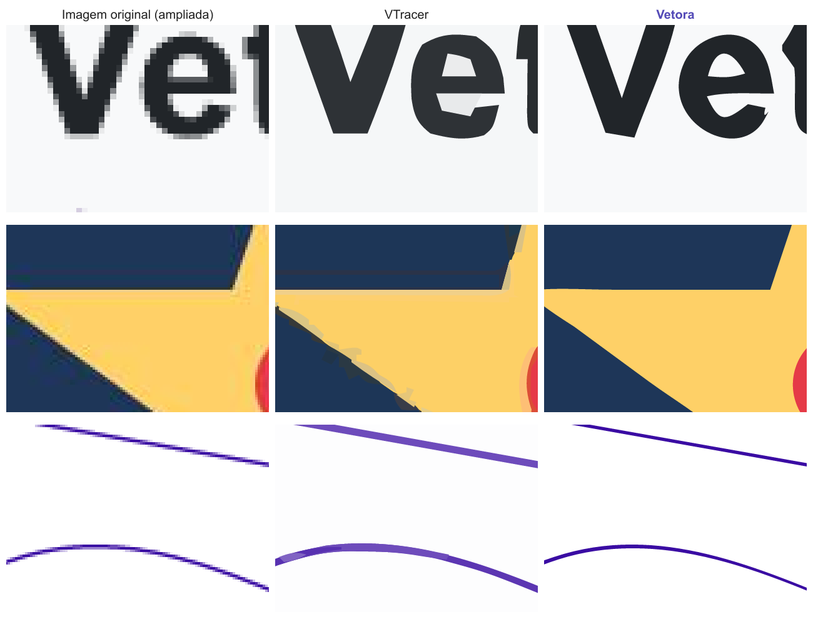

<p align="center">
  
</p>

<p align="center">
  <b>Vetorização de imagens de alta qualidade, direto no navegador.</b><br>
  PNG, JPG ou WebP → SVG, PDF, EPS, DXF ou PNG. Grátis, sem marca d'água e sem enviar sua imagem para nenhum servidor.
</p>

---

## O que ele faz

- **Bordas exatas:** cores vizinhas dividem a mesma curva, então não sobra fresta branca nem sobreposição.
- **Precisão sub-pixel:** usa o antialiasing da imagem original para pôr a borda no lugar real, não na grade de pixels.
- **Curvas limpas:** círculo sai como círculo, canto vivo sai vivo, com poucos nós e fácil de editar.
- **Cores certas:** o antialiasing não vira cor nova; o ruído e as franjas de JPEG são limpos.
- **Pronto para produção:** finalidades de Estampa (camadas por cor), Bordado, Adesivo, Corte a laser (DXF em mm) e Desenho a traço.
- **Editor:** trocar, apagar, juntar e adicionar cores (com conta-gotas), Borracha e Pincel por região, remover fundo, desfazer e refazer.
- **Exporta** SVG, PDF, EPS, DXF (R12) e PNG em até 8x; lote com download em .zip.
- **Privado e offline:** tudo roda no seu navegador (Web Worker) e funciona sem internet depois da primeira visita (PWA).

## Qualidade, medida

Banco de testes próprio (`bench/`): 12 desenhos-gabarito em PNG, PNG pequeno (140 px) e JPEG comprimido. Cada vetor é renderizado em 4x e comparado com o gabarito (ΔE médio; menor é melhor).

| variante | Vetora | VTracer |
| --- | --- | --- |
| PNG | **0,14** | 1,22 |
| imagem pequena | **0,57** | 2,62 |
| JPEG | **0,72** | 1,97 |

O Vetora foi mais fiel em 36 de 36 casos.



## Rodar no seu computador

Requer [Node.js](https://nodejs.org) 22 ou mais novo.

```bash
npm install
npm run dev        # http://localhost:5180
```

| comando | o que faz |
| --- | --- |
| `npm run dev` | modo desenvolvimento |
| `npm run build` | gera o site estático em `dist/` |
| `npm test` | testes do motor e da exportação |
| `npm run bench -- --save` | banco de qualidade (Vetora × VTracer); resultados em `bench/out/` |

No Windows, `Abrir Vetora.bat` faz tudo isso e abre o navegador.

## Como funciona

O **Motor Vetora** (`src/engine/`) é TypeScript puro, sem dependências:

1. **Ruído:** detecta o chiado de JPEG e aplica um filtro que preserva bordas.
2. **Paleta:** cores tiradas das áreas lisas (k-means em Lab); traços finos recuperados um a um; variações e franjas de JPEG absorvidas.
3. **Segmentação:** pixels de borda são explicados como mistura de duas cores vizinhas, e manchas pequenas somem.
4. **Mapa planar:** cada fronteira entre duas regiões vira uma única cadeia, compartilhada pelas duas.
5. **Sub-pixel:** cada ponto da fronteira é empurrado para a posição real usando a cobertura do antialiasing.
6. **Curvas:** cantos detectados em duas escalas e postos na interseção das retas; ajuste de Bézier cúbicas (Schneider); círculos exatos.
7. **Saída:** formas empilhadas ou recortadas, preenchimento de frestas, SVG/PDF/EPS/DXF gerados no próprio navegador.

```
src/engine/   motor de vetorização (roda em Web Worker)
src/lib/      exportação, carregamento de imagem, lote, predefinições
src/ui/       interface (React)
bench/        banco de testes de qualidade
replica/      engenharia reversa, arquitetura, testes e paridade
marca/        logo e nome
```

## Publicação

Publicado no Vercel: cada `push` na `main` gera uma nova versão do site. Não há servidor nem custo de infraestrutura.
